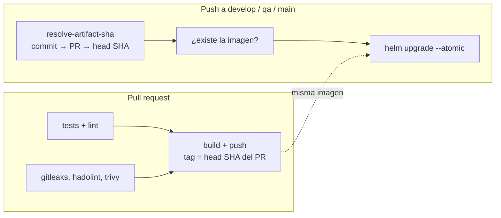

# github-actions-templates

[](https://github.com/tomaseduar60/github-actions-templates/actions/workflows/ci.yml)


Workflows reutilizables y composite actions para llevar un servicio desde el PR hasta GKE **sin llaves de service account** y **sin reconstruir la imagen al desplegar**.

## La idea central: construir una vez, promover siempre

La mayoría de los pipelines vuelven a construir la imagen en el push a `main`. Pero con squash o merge commits, el SHA de ese push no es el que se probó en el PR, y la imagen que llega a producción no es la que pasó los tests.

Acá la imagen se construye **una sola vez, en el PR**, con el head SHA del PR como tag. Al mergear, [`resolve-artifact-sha`](actions/resolve-artifact-sha) le pregunta a la API de GitHub qué PR originó el push y despliega esa imagen exacta.



## Contenido

### Workflows reutilizables

| Workflow | Para qué |
|---|---|
| [`reusable-node-ci.yml`](.github/workflows/reusable-node-ci.yml) | Lint, tests y umbral de cobertura para Node/TypeScript |
| [`reusable-python-ci.yml`](.github/workflows/reusable-python-ci.yml) | ruff, mypy y pytest con cobertura mínima |
| [`reusable-static-analysis.yml`](.github/workflows/reusable-static-analysis.yml) | Secretos (gitleaks), Dockerfile (hadolint) y dependencias (trivy) |
| [`reusable-build-push.yml`](.github/workflows/reusable-build-push.yml) | Build con Buildx y cache, SBOM, provenance, push a Artifact Registry y escaneo de la imagen |
| [`reusable-deploy-gke.yml`](.github/workflows/reusable-deploy-gke.yml) | Deploy con Helm a GKE promoviendo la imagen del PR, con Environments y concurrencia por ambiente |

### Composite actions

| Action | Para qué |
|---|---|
| [`gcp-auth`](actions/gcp-auth) | Login a GCP con Workload Identity Federation y a Artifact Registry |
| [`resolve-artifact-sha`](actions/resolve-artifact-sha) | Commit del push → PR mergeado → head SHA → imagen, validando que exista |

## Uso

En el repo del servicio, dos workflows chicos (ejemplos completos en [`examples/`](examples)):

```yaml
# .github/workflows/pull-request.yml
jobs:
  ci:
    uses: tomaseduar60/github-actions-templates/.github/workflows/reusable-node-ci.yml@v1
  static-analysis:
    uses: tomaseduar60/github-actions-templates/.github/workflows/reusable-static-analysis.yml@v1
  image:
    needs: [ci, static-analysis]
    uses: tomaseduar60/github-actions-templates/.github/workflows/reusable-build-push.yml@v1
    with:
      image: us-docker.pkg.dev/my-project/apps/orders-api
    secrets: inherit
```

```yaml
# .github/workflows/deploy.yml
on:
  push:
    branches: [develop, qa, main]
jobs:
  deploy:
    uses: tomaseduar60/github-actions-templates/.github/workflows/reusable-deploy-gke.yml@v1
    with:
      environment: ${{ github.ref_name == 'main' && 'production' || github.ref_name }}
      image: us-docker.pkg.dev/my-project/apps/orders-api
      cluster: gke-${{ github.ref_name }}
      location: us-central1
      namespace: orders
      release: orders-api
      values-file: chart/values-${{ github.ref_name }}.yaml
    secrets: inherit
```

## Ramas y ambientes

| Rama | Environment | Deploy |
|---|---|---|
| `develop` | develop | automático al mergear |
| `qa` | qa | automático al mergear |
| `main` | production | con aprobación del Environment |

Los cambios suben por PR `develop → qa → main`. Como cada promoción es un PR, cada ambiente recibe la imagen construida en su propio PR.

## Seguridad

- **Sin llaves JSON.** Todo con WIF; los tokens duran lo que dura el job. Ver [docs/wif-setup.md](docs/wif-setup.md).
- **Permisos mínimos.** Cada workflow declara solo los `permissions` que necesita; `id-token: write` únicamente donde hay que autenticarse.
- **PRs de forks.** El ejemplo de PR no publica imágenes si el PR viene de un fork.
- **Supply chain.** SBOM y provenance en cada imagen, escaneo con trivy antes de publicar.

## Desarrollo

```bash
bash tests/resolve-artifact-sha.sh   # tests con gh y docker simulados
```

El CI del repo corre actionlint, shellcheck y estos tests en cada PR.

## Versionado

Los consumidores apuntan a un tag mayor (`@v1`). Los cambios incompatibles salen en `v2`.

## Licencia

[MIT](LICENSE)
